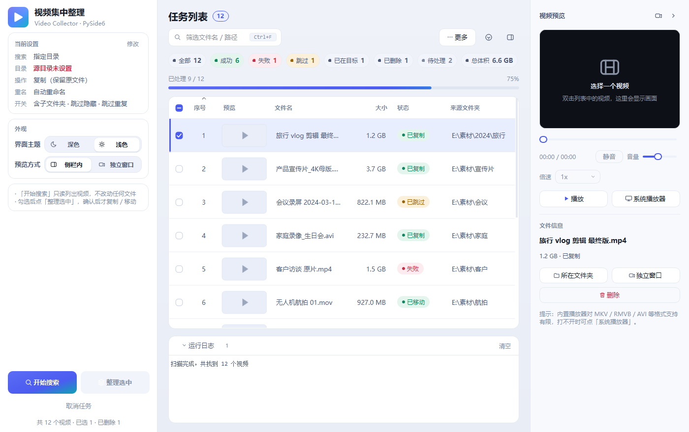
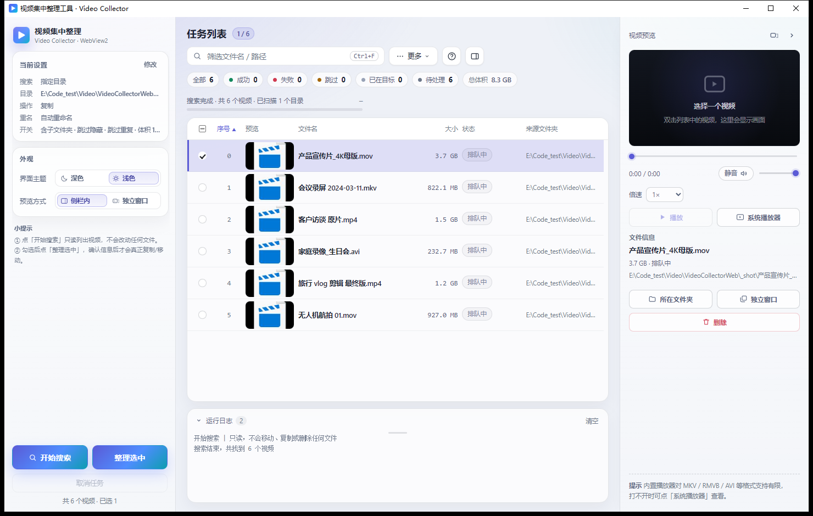
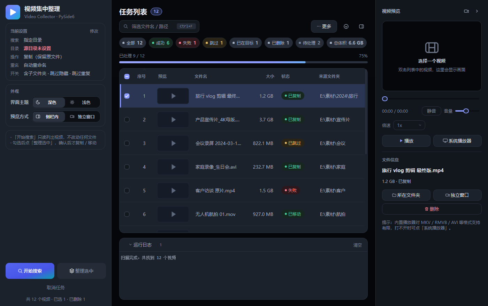
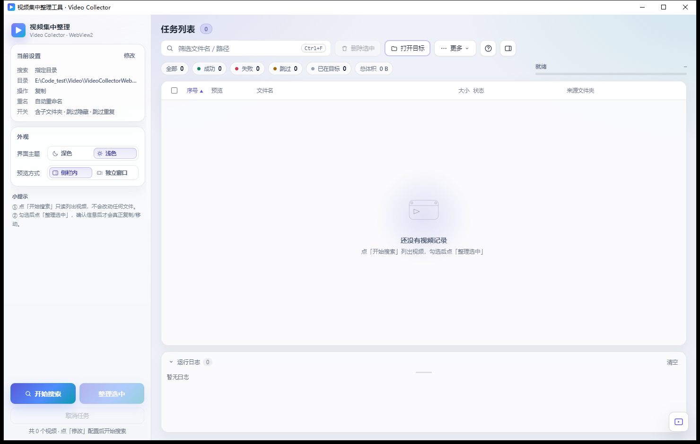

# 视频集中整理工具 · Video Collector

把散落在十几个下载目录里的视频，一次性收拢到一个"视频库"里。

同一套交互做了两个可独立运行的版本：**Python + PySide6** 和 **C++17 + WebView2**。两版的功能集、快捷键、界面结构、图标、缩略图缓存完全对齐——喜欢哪个装哪个，效果一样。

| Python 版（浅色） | C++ 版（浅色） |
| --- | --- |
|  |  |

<details>
<summary>深色主题 / 宽窗口</summary>




</details>

## 两个版本

| | Python 版 | C++ 版 |
| --- | --- | --- |
| 目录 | `pyVideo/` | `VideoCollectorWeb/` |
| 技术栈 | Python 3.8+ / PySide6 6 | C++17 / Win32 / WebView2（前端是 HTML+CSS+JS） |
| 界面 | Qt Widgets + 自绘控件 + 参数化 QSS | 无边框 Win32 窗口 + WebView2 承载内嵌页面 |
| 产物 | `VideoCollector.exe`，单文件，约 113 MB（含 opencv） | `VideoCollectorWeb.exe`，单文件，约 **2.1 MB** |
| 依赖 | Python + PySide6；opencv-python 可选（缩略图） | 系统已有 WebView2 运行时（Win10/11 自带） |
| 缩略图 | Qt + opencv 取首帧 | Windows Shell 缩略图（`IShellItemImageFactory`）+ GDI+ 转 JPG |
| 跨平台 | Windows / macOS / Linux | 仅 Windows |
| 适合 | 想改代码、跨平台 | 想拷一个 2 MB 的 exe 就走 |

两版的**缩略图缓存目录是同一个**（`~/.videocollector/thumbnails/`，键的算法一致），换版本不用重新生成。

## 功能

- **两阶段，写入可控**：先「开始搜索」只读列出视频（不动任何文件），勾选后才是「整理选中」——只有第二步才复制 / 移动。
- **复制或移动**，重名可选「自动重命名（`xxx (1).mp4`）」或「同名跳过」；复制完校验目标大小，不一致按失败处理并清理残缺文件。
- **全盘搜索（只读）**：手动勾选磁盘、自定义排除目录、结果上限；跳过系统目录、隐藏项、链接目录和目标文件夹自身，单目录读不动只记日志继续。
- **去重**：目标里已有同名且大小 + 首/中/尾各 64 KB 内容一致的文件时直接跳过，重复跑不会复制出一堆副本。
- **格式与体积过滤**：24 个常用扩展名可勾选 + 自定义；体积范围按 MB，任一端可留空。
- **勾选列 + 表头全选**：表头复选框支持未选 / 半选 / 全选三态；`Ctrl+A` 只作用于**当前可见行**，被筛掉的行自动取消选中。
- **预览播放**：双击行即播（任务运行中也能播，只有删除被禁用）；内置播放器打不开的格式可一键「系统播放器」或「独立窗口」。
- **删除到回收站**：`Delete` 或按钮，走 `SHFileOperation`（可撤销），运行中禁止删除；若目标里还有副本，弹窗里可勾选一起删。
- **状态筛选与导出**：顶部统计胶囊（全部 / 成功 / 失败 / 跳过 / 已在目标 / 已删除 / 待处理 / 总体积）点一下只看这一类；「更多」菜单里有导出 CSV（UTF-8 带 BOM）、导出自包含 HTML 报告、撤销本次整理。
- **四步设置向导**：搜索方式 → 格式与大小 → 操作方式与重名策略 → 开关；侧栏只留只读摘要卡，随时点「修改」重开。
- **深色 / 浅色双主题**，高 DPI 矢量绘制；窄窗口自动收纳（主区 < 980px 时把「删除选中 / 打开目标」收进「更多」，预览列收窄，必要时隐藏「来源文件夹」列）。

## 快速开始

### Python 版

```bash
cd pyVideo
pip install -r requirements.txt      # PySide6>=6.6（必需）、opencv-python>=4.5（缩略图可选）
python video_collector.py            # Windows 也可直接双击 启动.bat
```

打包成单文件 exe：

```bash
pip install pyinstaller
pyinstaller VideoCollector.spec --noconfirm
# 产物：dist/VideoCollector.exe
```

`VideoCollector.spec` 已配好单文件、无控制台、`hiddenimports=['cv2']`，并把 `assets/` 打进包里（否则 exe 的窗口与任务栏图标会退化成 Windows 默认图标）。

### C++ 版

需要两样东西：

1. **MSYS2 UCRT64 工具链**（`g++.exe`、`windres.exe`）。`build.bat` 顶部写死了 `D:\SoftWareNew\msys64\ucrt64\bin\`，换机器请改成自己的路径。
2. **WebView2 SDK**：从 NuGet 取 `Microsoft.Web.WebView2` 解压，只保留 `build/native/`（`include/` + `x64/WebView2LoaderStatic.lib`）到 `VideoCollectorWeb/sdk/build/native/`。仓库里**不提交**这份 SDK（40 MB+）。

```bash
cd VideoCollectorWeb
build.bat
# [1/3] embed_ui.ps1  把 ui/*.html、*.css、*.js 编成 C++ 字节数组
# [2/3] windres       编译 app.rc（图标 + 清单）
# [3/3] g++           链接 -> bin/VideoCollectorWeb.exe（单文件，不依赖 DLL / ui 目录）
```

> **改前端后必须重新 `build.bat`**：`ui/` 下的文件是通过 `tools/embed_ui.ps1` 内嵌进 `src/embedded_ui.cpp` 的，只改 `ui/` 不重编译，exe 里看到的还是旧界面。

## 目录结构

```
Video/
├── README.md
├── docs/screenshots/            # README 用的界面截图
├── tools/make_app_icon.py       # 一套几何渲染 9 个尺寸，同步两端图标资源
│
├── pyVideo/                     # Python + PySide6 版
│   ├── video_collector.py       # 入口
│   ├── app/
│   │   ├── main_window.py       # 三栏布局 / 表格 / 统计胶囊 / 预览 / 删除 / 报告
│   │   ├── setup_dialog.py      # 四步向导 + 扩展名勾选弹层
│   │   ├── table_model.py       # Model/View：取数、排序、筛选
│   │   ├── widgets.py           # 自绘控件：分段、开关、胶囊、勾选框、状态药丸、空状态插画
│   │   ├── theme.py             # 深浅两套色板 + 参数化 QSS
│   │   ├── worker.py            # 扫描 / 复制 / 移动后台线程
│   │   ├── scan_all.py          # 只读全盘搜索
│   │   ├── utils.py             # 回收站、去重、缩略图线程、资源路径
│   │   └── constants.py
│   ├── assets/                  # app.ico / app.png / app.svg
│   ├── VideoCollector.spec
│   └── version_info.txt
│
└── VideoCollectorWeb/           # C++ + WebView2 版
    ├── build.bat
    ├── src/
    │   ├── main.cpp             # Win32 无边框窗口 + WebView2 宿主 + 托盘/快捷键
    │   ├── backend.cpp          # 扫描、复制/移动、去重、回收站、报告
    │   ├── http_server.cpp      # 本地回环 HTTP：提供内嵌页面与 /thumb 缩略图
    │   ├── embedded_ui.cpp      # 由 embed_ui.ps1 生成（页面字节数组）
    │   └── app.rc / app.manifest（图标、DPI、longPathAware）
    ├── ui/                      # index.html / style.css / app.js / preview.*
    ├── tools/embed_ui.ps1
    └── res/                     # app.ico / app.png
```

## 使用

1. 首次启动弹**整理设置**向导（之后点侧栏「当前设置」右上角的「修改」可随时重开）：
   - ① 搜索方式：`指定目录`（选源目录）或 `全盘搜索`（只读扫描，可勾选磁盘）；
   - ② 格式与大小：勾选扩展名，填体积范围（MB，留空或 0 表示不限）；
   - ③ 操作方式：`复制`（原文件保留）或 `移动`；重名时 `自动重命名` 或 `同名跳过`；
   - ④ 开关：包含子文件夹 / 跳过隐藏项 / 跳过相同视频 / 完成后打开目标。
2. 点**开始搜索** —— 只读列清单，日志会写明「只读，不会移动或删除任何文件」。
3. 勾选要整理的视频 → **整理选中**。移动模式会先确认一次（源文件会被移走）。每行状态变成 `已复制 / 已移动 / 跳过 / 失败：原因`。
4. 双击行预览；不要的 `Delete` 进回收站；收尾用「更多 → 导出 CSV / 导出报告 / 撤销本次整理」。

快捷键（两版一致）：

| 键 | 作用 |
| --- | --- |
| `Ctrl+F` | 聚焦筛选框（按文件名 / 路径 / 状态实时过滤） |
| `Ctrl+A` / `Ctrl+Shift+A` | 全选当前可见行 / 取消全选 |
| `Enter` | 预览选中的视频 |
| `Delete` | 把选中项移入回收站 |
| `Esc` | 清除筛选；无筛选时取消选中 |
| `F1` | 快捷键与操作说明 |

## 实现要点

**Python 版**

- 表格是真正的 **Model/View**（`table_model.py`）：数据只存在 `MainWindow.rows` 一份，列现取现格式化；两万行不为每个格子创建 `QTableWidgetItem`，排序不重排控件、筛选不逐行开关隐藏，刷新是 O(可视行)。
- 行定位用稳定 UID：`uid → 行号` 由代理模型 `mapFromSource/mapToSource` 现算，排序 / 筛选 / 删除 / 缩略图回填都不会写错行；新增行按小批 `beginInsertRows` 插入。
- 勾选列是自绘的：`CheckHeaderView` 用 `selectionModel().selectedRows(COL_CHECK).count()` 与 `rowCount()` 比出三态，`mousePressEvent` 在列 0 接管点击，避免第一下被视图的默认选择逻辑吃掉。
- 缩略图按可视行懒加载，模型层 LRU 保留 400 张 `QPixmap`，磁盘缓存上限 256 MB（mtime LRU 清理）。
- 所有自绘控件都实现 `apply_theme()`，切主题时 `MainWindow._apply_theme` 遍历 `findChildren(QWidget)` 逐个重刷。

**C++ 版**

- 单个 exe：`ui/` 被 `embed_ui.ps1` 编成字节数组随二进制分发，运行时由内置的本地回环 HTTP 服务供给 WebView2，`WebView2Loader` 静态链接，因此**不需要** `ui` 目录或 `WebView2Loader.dll`。
- 文件操作全在原生侧（`backend.cpp`）：扫描、去重、复制/移动、大小校验、回收站、CSV/HTML 报告；前端只发命令、收状态。
- 缩略图走 `IShellItemImageFactory` 取系统缩略图，GDI+ 转 JPG 落盘，与 Python 版共用缓存目录与键算法。
- `app.manifest` 声明 `longPathAware`，系统开启长路径后 > 260 字符的路径可直接用，**不拼** `\\?\` 前缀（那会让回收站与 Shell 定位失效）。

**共同约定**

- 删除默认走 Windows 回收站（带"允许撤销"标志），回收站不可用时报错，绝不偷偷改成永久删除。
- 筛选状态下全选 / 删除只作用于可见行。
- 去重是"快速指纹"：采样首 / 中 / 尾各 64 KB，属概率判重；可疑重复项建议临时关掉「跳过相同视频」再跑一遍。

## 已知限制

- 只按扩展名识别视频，不解析文件头：改了后缀的假视频也会被收进来。
- 内置播放器依赖系统解码器：`.mp4 / .mov / .wmv / .avi` 一般没问题，部分 `.mkv / .rmvb / .ts` 打不开，请用「系统播放器」。
- 移动模式是"剪切"，不是 Windows 可撤销操作；回退请用「撤销本次整理」（只处理最近一次，且目标副本仍存在）。
- 超长路径需要系统开启 `LongPathsEnabled`（Win10 1607+），未开启时按失败处理并写明原因。
- C++ 版仅 Windows；Python 版在 macOS / Linux 上删除是直接删（仍有确认弹窗）。
- 不做转码、不重命名内容、不按日期分文件夹——它的职责就是把文件搬到位。
